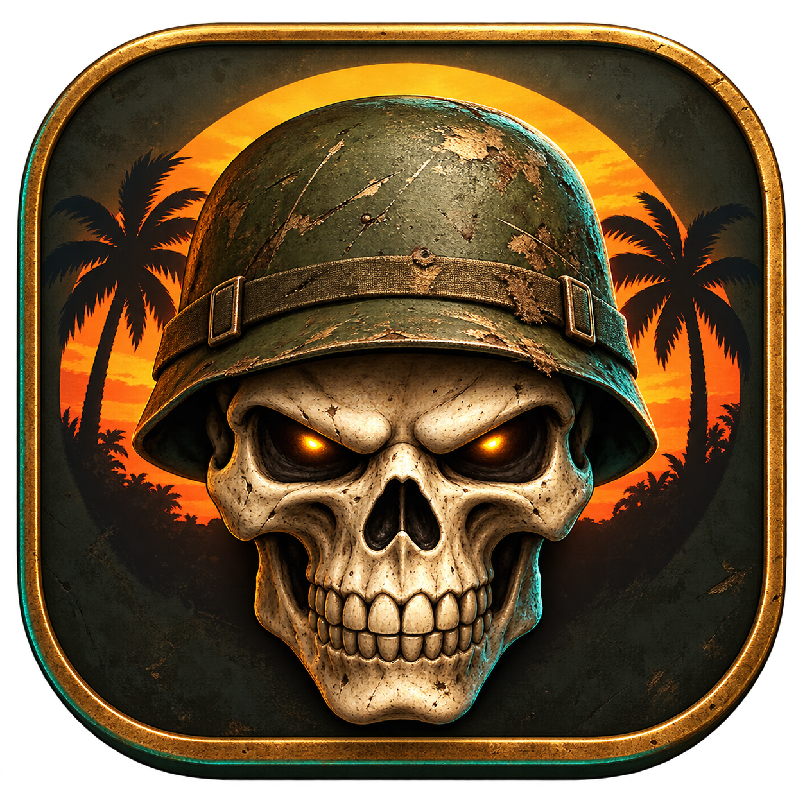
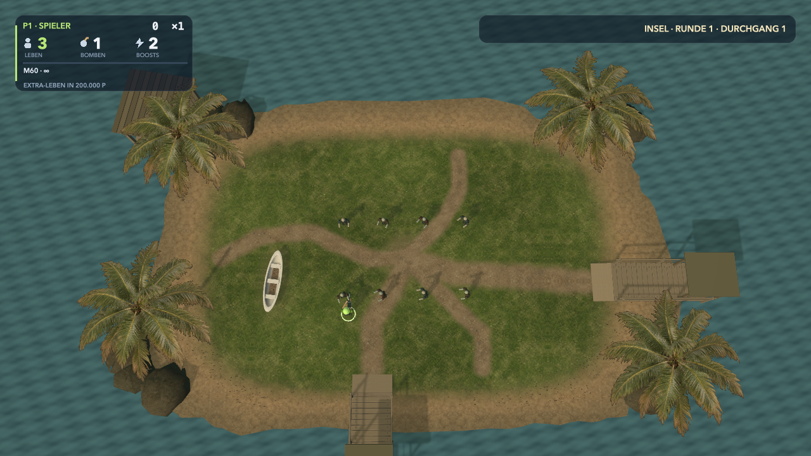
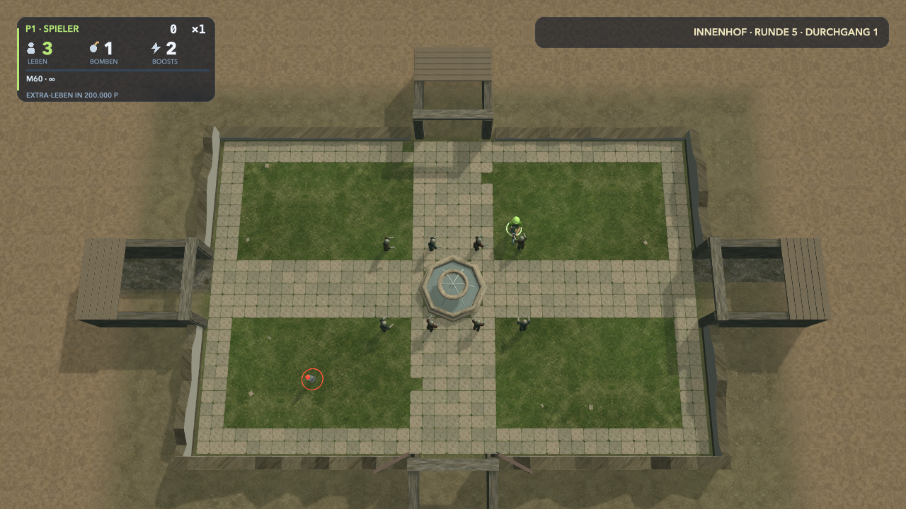
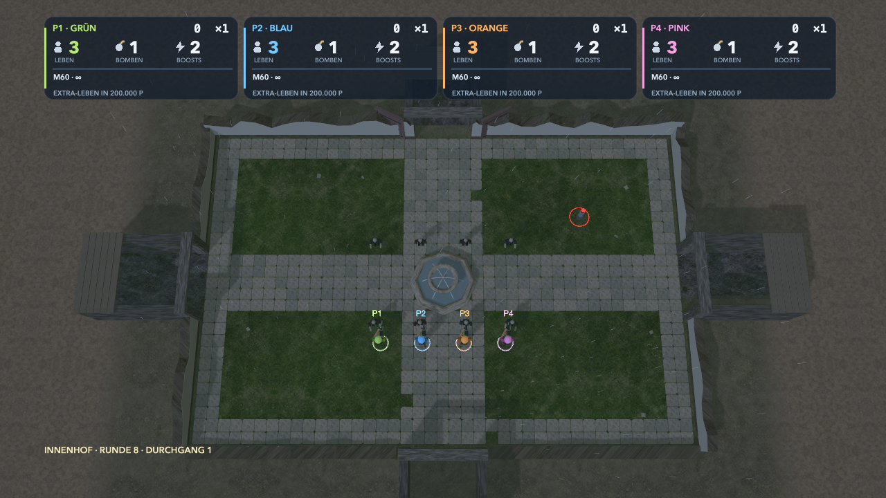

<div align="center">
  
  <h1>Dead Ops Reconstruction</h1>
  <p><strong>Arcade-Action für deinen Mac. Allein oder mit Freunden.</strong></p>
  <p>Bewegen, ausweichen, bessere Waffen finden – und die nächste Welle überstehen.</p>
  <p><code>Vorabversion 0.81</code> · <code>1–4 Spieler lokal</code> · <code>Mac mit Apple-Chip</code></p>
  <p><a href="https://github.com/loserat/dead-ops-reconstruction/releases/download/v0.81/DeadOps-Reconstruction-0.81-macOS-arm64.zip"></a></p>
  <p>55 MB · macOS 14 oder neuer · Kein Xcode nötig</p>
</div>

<p align="center">
  <a href="#losspielen">Losspielen</a> ·
  <a href="#einblicke">Bilder</a> ·
  <a href="#steuerung">Steuerung</a> ·
  <a href="#entwicklungsstand">Entwicklungsstand</a> ·
  <a href="#weiterentwickeln">Weiterentwickeln</a>
</p>

## Losspielen

1. **[Mac-App herunterladen](https://github.com/loserat/dead-ops-reconstruction/releases/download/v0.81/DeadOps-Reconstruction-0.81-macOS-arm64.zip)** und das ZIP entpacken.
2. **Dead Ops Reconstruction.app** in deinen Ordner **Programme** ziehen.
3. Die App öffnen und mit Tastatur oder Controller loslegen.

Du brauchst einen **Mac mit Apple-Chip (M1 oder neuer) und macOS 14+**. Entwicklungssoftware ist zum Spielen nicht erforderlich.

**Beim ersten Start:** Die Vorabversion ist lokal signiert und noch nicht von Apple notarisiert. macOS kann deshalb eine zusätzliche Freigabe verlangen. Die [kurze Starthilfe](docs/INSTALLATION.md#erster-start) führt dich durch diesen Schritt. Im [Release](https://github.com/loserat/dead-ops-reconstruction/releases/tag/v0.81) findest du außerdem die Prüfsumme des Downloads.

## Das erwartet dich

Dead Ops Reconstruction ist ein eigenes natives Arcade-Projekt, inspiriert vom ursprünglichen **Dead Ops Arcade aus Call of Duty: Black Ops**. Du bewegst und zielst unabhängig voneinander, sammelst Ausrüstung und hältst dir gemeinsam mit deinem Team den Weg frei.

- **Twin-Stick-Kampf:** Bewegen mit dem linken Stick, zielen und schießen mit dem rechten. Tastatursteuerung ist ebenfalls vorhanden.
- **Waffen und Fahrzeuge:** Sieben Waffen-Grundtypen, Panzer, Hubschrauber, Begleiter und weitere Hilfsmittel.
- **Übersichtliche Arena:** Die automatische Kamera zeigt die ganze spielbare Karte und die nahen Zugänge. Gegner laufen über tatsächliche Anmarschwege hinein.
- **Fortschritt:** Schätze, Multiplikator, Nebenräume und Schicksale. Alle 200.000 Punkte wird ein persönlicher Lebensfund ausgelöst, den du einsammeln musst.
- **Gemeinsam spielen:** Lokaler Koop für bis zu vier Spieler mit eigenen Farben und Anzeigen. Ein aktueller Test mit mehreren physischen Controllern steht noch aus.

<details>
<summary><strong>Welche Waffen und Einstellungen sind enthalten?</strong></summary>

M60, Death Machine, SPAS-12, RPG, Ray Gun, China Lake und M2-Flammenwerfer haben eigene Angriffsarten. Waffenwirkung und Fahrzeuggefühl werden weiter abgestimmt.

In den Einstellungen kannst du Ton, Helligkeit und Spielerfarben anpassen. Zum entspannten Erkunden gibt es Godmode; virtuelle Lebensverluste werden dabei weiter gezählt.

</details>

## Einblicke

### Insel – die ersten Schritte



Die ersten vier Runden spielen auf der Insel. Strand und Stege bilden die Zugänge; behalte die anlaufenden Gegner im Blick.

### Innenhof – neue Wege, neue Angriffswinkel



Ab Runde 5 geht es in den Innenhof. Brunnen und gekreuzte Wege prägen die Bewegung. Die ersten acht Runden verteilen sich auf diese beiden Arenen.

### Koop – vier Farben, eine Arena



Alle Spieler teilen sich die Arena und die Kamera. Eigene Farben und Statuskarten zeigen dir, wer wo unterwegs ist und welche Vorräte noch verfügbar sind.

*Die Bilder zeigen eigene In-Engine-Testszenen der Version 0.81. Es sind kontrollierte Spielzustände aus unserem Renderer. [Bildherkunft und Prüfsummen](docs/SCREENSHOTS.json).*

## Steuerung

| Aktion | Tastatur | PS5-/kompatibler Controller |
|---|---|---|
| **Bewegen** | WASD | Linker Stick |
| **Zielen und schießen** | Pfeiltasten | Rechter Stick |
| **Boost** | Leertaste | R1 oder R2 |
| **Bombe** | B | L1 oder L2 |
| **Bestätigen** | Eingabe | Kreuz / untere Aktionstaste |
| **Pause** | Escape | Options / Menü |
| **Zurück im Menü** | Menüführung | Kreis / rechte Aktionstaste |

## Entwicklungsstand

**0.81 ist eine spielbare Vorabversion.** Eigene Grafiken, Modelle und Geräusche sind vorhanden. Originalwerte, Kartenoptik und Abläufe werden noch verfeinert.

Als Nächstes stehen flüssiger Betrieb bei hoher Last, Spielgefühl und Erkennbarkeit im Mittelpunkt. Stabile 60 FPS sowie aktuelle Fremd-Mac-, Controller- und Hörtests sind noch offen. Apple TV hat ein eigenes Entwicklungsziel; der Mac-Download ist für macOS bestimmt.

Wenn dir etwas auffällt, freuen wir uns über [einen Fehlerbericht](https://github.com/loserat/dead-ops-reconstruction/issues/new). Mac-Modell, Spielrunde und verwendete Steuerung helfen beim Nachstellen.

<details>
<summary><strong>Welche Prüfungen gibt es bereits?</strong></summary>

Für den Spielquellstand 0.81 sind Mac- und tvOS-SDK-Builds, 55 Logik-Prüfprogramme und sechs automatische Acht-Runden-Durchläufe bestanden. Dazu kommen native Paket- und Kameraprüfungen. Das veröffentlichte ZIP wurde erneut heruntergeladen und per Prüfsumme geprüft.

Die [Prüfdokumentation](docs/TESTING.md) erklärt Umfang und Grenzen. Automatisierte Prüfungen ersetzen keine menschliche Spielrunde oder Prüfung auf einem anderen Gerät.

</details>

Die [Roadmap](docs/ROADMAP.md) zeigt die nächsten Schritte. Weitere Informationen zu Installation und Apple TV findest du in der [Anleitung](docs/INSTALLATION.md).

## Weiterentwickeln

Der Quellcode verwendet **Swift, SceneKit, SpriteKit und GameController**. Zum Bauen brauchst du Xcode, Python 3 und einen Mac mit Apple-Chip.

```sh
git clone https://github.com/loserat/dead-ops-reconstruction.git
cd dead-ops-reconstruction
./build.sh mac
open Build/Mac/DeadOpsReconstruction.app
```

Alternativ das Xcode-Projekt öffnen und **Dead Ops Mac → My Mac** starten.

[Architektur](docs/ARCHITECTURE.md) · [Workflow](docs/WORKFLOW.md) · [Prüfungen](docs/TESTING.md) · [Veröffentlichungsprüfung](docs/PUBLISHING.md) · [Mitwirken](CONTRIBUTING.md) · [Changelog](CHANGELOG.md)

---

*Inoffizielles Entwicklungsprojekt. [Quellen und eigene Inhalte](docs/REFERENCES.md) · [Lizenzstatus](LICENSE.md). Eine Open-Source-Lizenz ist bisher nicht ausgewählt.*
